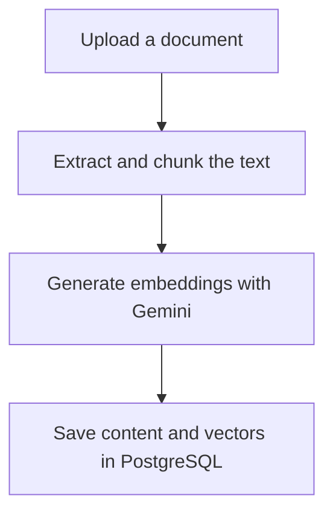
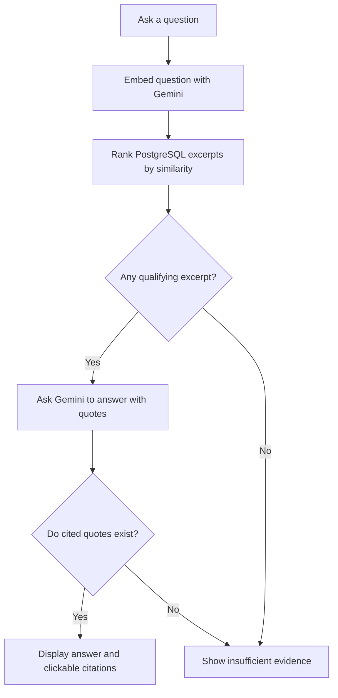

# How DocDesk works

DocDesk applies retrieval-augmented generation (RAG). Retrieval finds relevant excerpts. Generation uses those excerpts to answer the question.

## Upload and indexing

A chunk is a short section of document text. Chunks overlap so nearby words stay together when a sentence crosses a chunk boundary. An embedding is a list of numbers representing a chunk’s meaning. PostgreSQL stores the chunk, its vector, and its source location together. A file hash detects identical uploads. The transaction commits only when every chunk is ready.

## Question and answer

If you ask how long students can borrow books, semantic search can retrieve a passage about a *loan period*. The app sends up to five passages to the chat model. Each statement must include a quote. Python verifies the quote against the selected excerpt before sending the statement to the page.

## Database and failure behavior

| PostgreSQL table | Purpose |
| --- | --- |
| `documents` | One row per upload, including filename, file hash, and chunk count. |
| `chunks` | Excerpt text, source location, and the normalized vector. |
| `index_config` | Records the embedding model and vector size. |

A failed Gemini embedding request leaves the database unchanged. Concurrent uploads serialize the final duplicate check and insert. Deleting a document deletes its chunks. The service pool bounds database connections. The browser returns a readable error if the provider or database is unavailable.

Cosine search scans the allowed vectors in Python. This keeps the ranking code easy to follow. A larger deployment would need measured retrieval quality, a vector index, separate ingestion workers, and an access model for private libraries. Matching quotes and prompt instructions reduce some errors. They cannot prove that every generated statement is supported.
